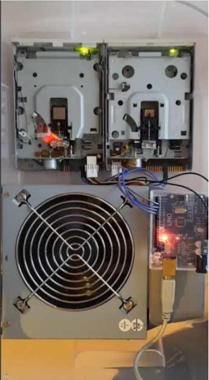
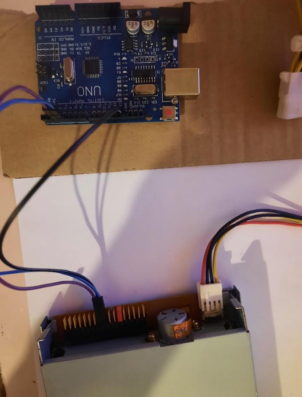
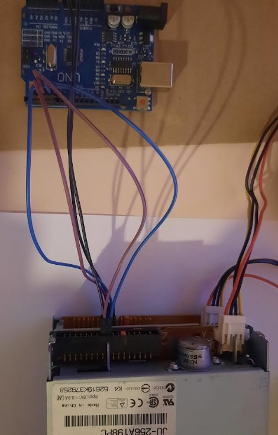

# Floppy Music

Floppy Music je moj zaključni projekt na Srednji šoli Domžale (program Tehnik računalništva, februar 2025). Dva stara 3,5-palčna disketna pogona sem spremenil v glasbeni instrument. Arduino Uno pretvarja glasbo iz MIDI datotek v korake koračnih motorjev, gibanje bralnih glav pa ustvarja tone. Vse skupaj sem vgradil v prozorno ohišje.

  

## Kako deluje

Računalnik v programu Moppy predvaja MIDI datoteko in prek USB pošilja note Arduinu. Arduino za vsak pogon s hitrostjo impulzov na pinu STEP določa višino tona, s pinom DIRECTION pa ob koncu poti obrne smer glave. Vsak pogon igra svojo glasbeno linijo: prvi melodijo, drugi spremljavo.

## Strojna oprema

| Komponenta | Namen |
| --- | --- |
| 2 × 3,5" disketni pogon | ustvarjanje zvoka s premikanjem bralne glave |
| Arduino Uno | krmiljenje koračnih motorjev pogonov |
| ATX računalniški napajalnik | napajanje pogonov (zagon brez matične plošče s premostitvijo PS-ON na GND) |
| Prozorno plastično ohišje | pregleden in zaščiten sestav |

## Vezava

Pin 0 in 1 na Arduinu sta izpuščena, ker ju uporablja serijska komunikacija z računalnikom. Na vsakem pogonu sta pina 11 in 12 povezana med seboj, da je pogon izbran (drive select).

| Disketni pogon | Signal | Arduino (1. pogon) | Arduino (2. pogon) |
| --- | --- | --- | --- |
| pin 20 | STEP (korak) | pin 2 | pin 4 |
| pin 18 | DIRECTION (smer) | pin 3 | pin 5 |
| pin 17 | GND | GND | GND |

  
  

## Programska oprema

1. **Arduino IDE** s knjižnico **TimerOne**: na Arduino sem naložil skico `Moppy.ino` iz projekta [Moppy](https://github.com/SammyIAm/Moppy). Težavo z nezdružljivo različico knjižnice sem rešil z njeno ročno posodobitvijo.
2. **MoppyDesk** (Java, zagnan v NetBeans): izbira COM vrat Arduina in predvajanje MIDI datotek. Najnovejši JDK z Moppyjem ni deloval, zato sem uporabil JDK 21.
3. **MuseScore Studio 4**: priprava MIDI datotek. Odstranil sem neuporabljene kanale, bobne in prenizke tone. Glavno melodijo sem dodelil prvemu pogonu, spremljavo pa drugemu.

## Kaj sem se naučil

- branje pinoutov in ročno testiranje koračnega motorja pred priklopom na mikrokrmilnik
- varno delo z ATX napajalnikom zunaj računalnika
- primerjava mikrokrmilnikov (Arduino Uno, ESP8266, Raspberry Pi) in izbira glede na nalogo
- reševanje težav z združljivostjo različic (knjižnica TimerOne, različica JDK)
- prilagajanje MIDI datotek omejitvam instrumenta

## Možne izboljšave

- LED osvetlitev, sinhronizirana z glasbo
- več pogonov za bogatejše večglasje
- samostojno predvajanje s SD kartice, brez računalnika

## Viri

- [Moppy](https://github.com/SammyIAm/Moppy) (Sammy1Am): programska oprema za Arduino in računalnik
- [Musical Floppy Drives](https://www.instructables.com/Musical-Floppy-Drives/) (Instructables): navodila za izdelavo
